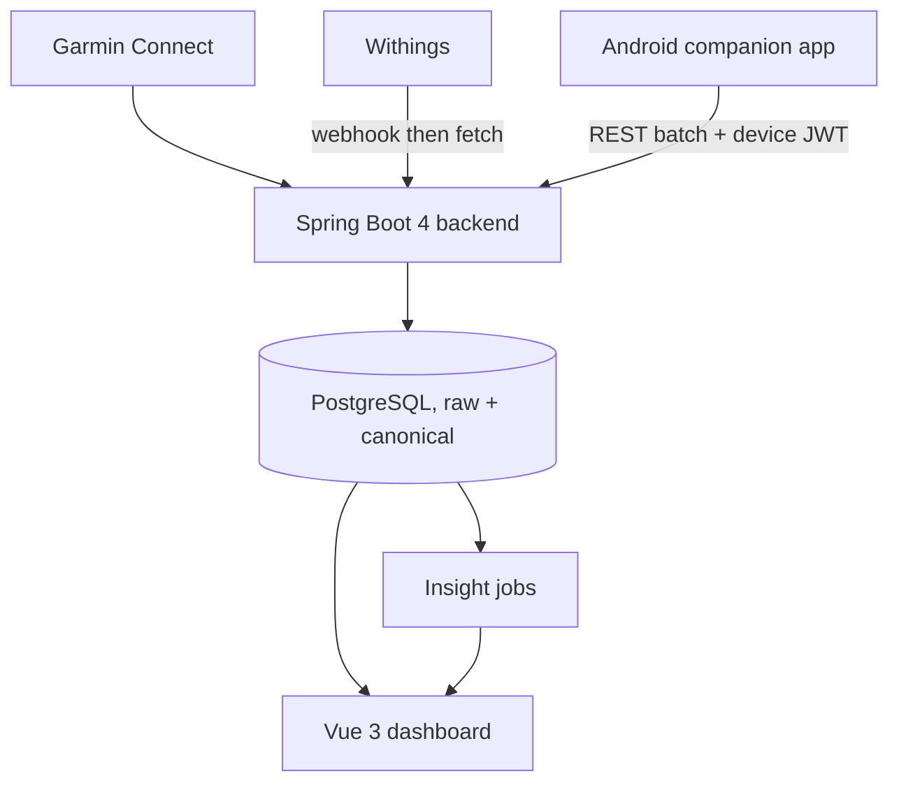

# HealthHub

A personal health and wellbeing aggregation platform. HealthHub pulls physical metrics from the devices you already own (Garmin, Withings, Android), captures mental wellbeing signals that most dashboards ignore (screen time, per-app usage, meditation, mood), and exposes everything through one canonical API that belongs to you, not to the vendors.

## Why it exists

Wearable and health vendors keep your data in silos with different schemas, units, and export policies. HealthHub removes that friction with one decision: the only contract in this codebase is our own canonical model. Vendor adapters normalize at the edge, everything downstream (Vue dashboard, Android companion, insight jobs) speaks the canonical API, and any vendor can be replaced without touching anything outside its adapter module.

Mental wellbeing is a first-class domain, not a footnote. Screen time has no cloud API anywhere, meditation lives in Health Connect mindfulness records, and mood has no standard at all, so those capture paths are built into the architecture from day one.

## Data sources

| Source | Data captured | How |
| --- | --- | --- |
| Garmin | Steps, sleep stages, HRV, resting HR, stress, sport activities | Garmin Connect Personal API (self-serve key, pull) |
| Withings | Weight, body composition, blood pressure, sleep, heart | Withings Public API (OAuth 2.0, webhooks + delta fetch) |
| Health Connect | Steps, sleep, heart rate, exercise sessions, mindfulness sessions | Android companion app reads on-device |
| Android system | Screen time, per-app foreground usage | UsageStatsManager (usage access permission), estimated values |
| Manual | Mood check-ins (valence + labels), activities without a tracker | Companion app forms, written back to Health Connect where applicable |

## Architecture



Three properties hold everywhere: ingestion is idempotent ((provider, provider_record_id) uniqueness, replay-safe upserts), every vendor payload is kept raw in JSONB before normalization so mapping bugs never lose data, and all timestamps are stored in UTC with explicit zone offsets.

## Tech stack

| Layer | Choice |
| --- | --- |
| Backend | Spring Boot 4.1, Java 25, Jakarta EE 11, Jackson 3, Spring Security (resource-server JWT) |
| Storage | PostgreSQL, Flyway migrations, JSONB raw retention |
| Frontend | Vue 3 (Composition API), TypeScript, Vite, Pinia, ECharts |
| Android | Kotlin, Jetpack Compose, Health Connect SDK, WorkManager, Room |
| Testing | JUnit 5, Testcontainers, WireMock, vitest |
| Ops | Docker Compose, CI on every push |

## Repository layout

```
healthhub/
├── backend/
│   ├── app/               # assembly, config, security
│   ├── core-domain/       # canonical model, no vendor dependencies
│   ├── providers/         # withings/, garmin/ adapters behind a Port
│   ├── ingestion/         # idempotent pipeline, raw events
│   ├── api/               # canonical REST + SSE, OpenAPI
│   ├── companion-api/     # batch upload endpoints
│   └── insights/          # daily rollups, weekly training volume
├── frontend/              # Vue 3 SPA
├── android/               # companion app
├── infra/                  # docker-compose, CI
└── docs/                   # ADRs, openapi.yaml, fixtures
```

The contract lives in `docs/openapi.yaml`. It is written before implementation and is the single source of truth for the browser and Android clients. Highlights:

```
GET  /api/v1/dailies?from&to          # one row per day, all sources merged
GET  /api/v1/series/{metricType}     # time series, source-segmented
GET  /api/v1/activities              # sport sessions + manual entries
GET  /api/v1/mental/sessions         # meditation, breathing, movement
GET  /api/v1/mental/usage/daily      # screen minutes, per-app
GET  /api/v1/mood/checkins           # valence, labels, notes
GET  /api/v1/events/stream           # SSE live updates
GET  /api/v1/export                  # full JSON/CSV export
DELETE /api/v1/data                  # async deletion
```

## Getting started

Prerequisites: JDK 25, Node 22, Docker, Android Studio (for the companion app).

```
# everything at once: postgres + backend (:8080) + frontend (:5173)
./scripts/dev.sh            # Ctrl+C stops all; --down also stops postgres, --no-db uses your own DATABASE_URL

# or step by step (PostgreSQL lives in infra/docker-compose.yml; POSTGRES_PASSWORD is required)
POSTGRES_PASSWORD=change-me docker compose -f infra/docker-compose.yml up -d postgres
./mvnw install -DskipTests               # builds all backend modules into ~/.m2
./mvnw -pl backend/app spring-boot:run    # app + migrations + actuator on :8080

# frontend
cd frontend && npm install && npm run dev

# android
open android/ in Android Studio, select a device or API 34+ emulator

# tests
./mvnw test                 # backend, Testcontainers requires Docker (android/ stays on Gradle)
cd frontend && npm run test
```

The backend runs in fixture mode until real vendor credentials exist. Set them in the environment when you have them:

```
GARMIN_PERSONAL_KEY=       # from Garmin Connect Web, Personal API key page
WITHINGS_CLIENT_ID=
WITHINGS_CLIENT_SECRET=
WITHINGS_CALLBACK_SECRET=
TOKEN_ENCRYPTION_KEY=     # AES-256 key for provider token storage
JWT_SIGNING_KEY=
```

Integration tests run against recorded fixtures in `docs/fixtures/`. Real vendor endpoints are never called from the test suite, and no task in the build pipeline may invent a vendor endpoint or field name.

## Privacy and data handling

Health and mental data is the most sensitive category you can store. This project treats it accordingly, as architecture rather than ceremony:

- Provider tokens are encrypted at rest (AES-GCM). Secrets exist only in environment variables.
- Raw vendor payloads are retained with normalization status, auditable and reprocessable, purged after 24 months.
- Every user-facing stream records consent per source, and a deletion job removes data and tokens with a completion event.
- Sport and screen-time figures are presented as measurements and estimates respectively, never as diagnoses or advice.
- Garmin's developer agreement prohibits training AI models on their data; this project does not do so, and no export path introduces vendor terms for downstream consumers.
- Logs are structured and scanned for token leakage in CI.

## Roadmap

| Milestone | Scope | Status |
| --- | --- | --- |
| M0 | Monorepo skeleton, green CI | Done |
| M1 | OpenAPI contract, core domain, idempotent ingestion, security | Done |
| M2 | Withings end to end (OAuth, webhooks, read API) | Done |
| M3 | Garmin Personal API adapter and sync orchestration | Done |
| M4 | Android companion app: Health Connect, usage stats, mood, upload | Done |
| M5 | Vue dashboard: Today, Trends, Activities, Mental, Sources | Done |
| M6 | Insights, export, deletion, hexagonal boundary verification | Done |
| M7 | Build system: backend migrates to Maven (Android stays on Gradle) | Done |
| M8 | Frontend audited + updated against specification.website (foundations, a11y, security, performance, resilience, i18n, privacy) | Done |
| M9 | Frontend i18n: English, French, Arabic (RTL), Chinese, Russian — vue-i18n, language switcher, Intl locale formatting | Done |
| M10 | Per-user provider credentials via authenticated API, stored AES-GCM encrypted (env = fallback/master keys); providers addable dynamically | Done |
| M11 | Observability: structured request/service logs with mandatory redaction — no secrets or tokens ever logged | Done |
| M12 | Docs review: README/PLAN/AGENTS fixed (compose path, Maven run sequence, roadmap, env vars, overclaims) | Done |
| M13 | One-command local dev: scripts/dev.sh (Postgres + backend + frontend), Vite dev proxy to :8080, gitignored .dev-env for local secrets | Done |

Detailed, acceptance-criteria per task, is in the build plan for AI agents, alongside the decision records that lock the architecture.

## Contributing

Tasks are dispatched and tracked from the build plan. One task per branch, commit format `task(TASK-ID): summary`, the full test suite must pass before merge. Tasks must not modify files owned by another in-progress task, and vendor integrations run on fixtures until credentials are provided.
