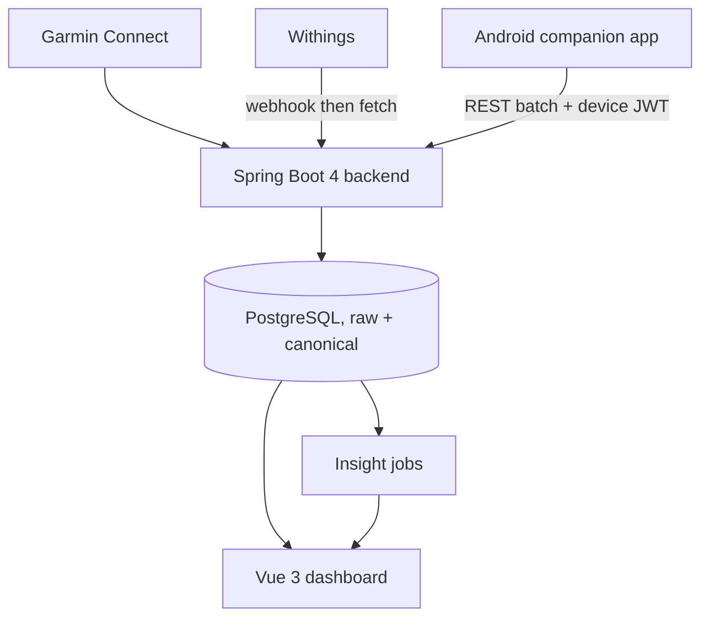

# Inside My Skin - HealthHub

A personal health and wellbeing aggregation platform. HealthHub pulls physical metrics from the devices you already own (Garmin, Withings, Android), captures mental wellbeing signals that most dashboards ignore (screen time, per-app usage, meditation, mood), and exposes everything through one canonical API that belongs to you, not to the vendors.

## Why it exists

Wearable and health vendors keep your data in silos with different schemas, units, and export policies. HealthHub removes that friction with one decision: the only contract in this codebase is our own canonical model. Vendor adapters normalize at the edge, everything downstream (Vue dashboard, Android companion, insight jobs) speaks the canonical API, and any vendor can be replaced without touching anything outside its adapter module.

Mental wellbeing is a first-class domain, not a footnote. Screen time has no cloud API anywhere, meditation lives in Health Connect mindfulness records, and mood has no standard at all, so those capture paths are built into the architecture from day one.

## Data sources

| Source | Data captured | How |
| --- | --- | --- |
| Garmin | Steps, sleep stages, HRV, resting HR, stress, sport activities | Garmin Connect Personal API (self-serve key, pull) |
| Withings | Weight, body composition, blood pressure, sleep, heart | Withings Public API (OAuth 2.0, webhooks + delta fetch) |
| Health Connect | Steps, sleep, heart rate, exercise sessions, mindfulness sessions | Android companion app reads on-device |
| Android system | Screen time, per-app foreground usage | UsageStatsManager (usage access permission), estimated values |
| Manual | Mood check-ins (valence + labels), activities without a tracker | Companion app forms, written back to Health Connect where applicable |

## Architecture



Three properties hold everywhere: ingestion is idempotent ((provider, provider_record_id) uniqueness, replay-safe upserts), every vendor payload is kept raw in JSONB before normalization so mapping bugs never lose data, and all timestamps are stored in UTC with explicit zone offsets.

## Tech stack

| Layer | Choice |
| --- | --- |
| Backend | Spring Boot 4.1, Java 25, Maven multi-module, Jakarta EE 11, Jackson 3, Spring Security (resource-server JWT) |
| Storage | PostgreSQL, Flyway migrations, JSONB raw retention |
| Frontend | Vue 3 (Composition API), TypeScript, Vite, Pinia, ECharts |
| Android | Kotlin, Jetpack Compose, Health Connect SDK, WorkManager, Room |
| Testing | JUnit, Testcontainers, WireMock, ArchUnit, vitest |
| Ops | Docker Compose (`infra/docker-compose.yml`), Maven wrapper (`./mvnw`), CI on every push |

## Repository layout

```
healthhub/
├── backend/
│   ├── app/               # assembly, config, security
│   ├── core-domain/       # canonical model, no vendor dependencies
│   ├── providers/         # withings/, garmin/ adapters behind a Port
│   ├── ingestion/         # idempotent pipeline, raw events
│   ├── api/               # canonical REST + SSE, OpenAPI
│   ├── companion-api/     # batch upload endpoints
│   ├── insights/          # daily rollups, weekly training volume
│   └── architecture/      # ArchUnit hexagonal-boundary tests
├── frontend/              # Vue 3 SPA
├── android/               # companion app
├── infra/                  # docker-compose.yml, scripts
├── .github/workflows/      # CI
└── docs/                   # ADRs, openapi.yaml, fixtures, task files
```

The contract lives in `docs/openapi.yaml`. It is written before implementation and is the single source of truth for the browser and Android clients. Highlights:

```
GET  /api/v1/dailies?from&to          # one row per day, all sources merged
GET  /api/v1/series/{metricType}     # time series, source-segmented
GET  /api/v1/activities              # sport sessions + manual entries
GET  /api/v1/mental/sessions         # meditation, breathing, movement
GET  /api/v1/mental/usage/daily      # screen minutes, per-app
GET  /api/v1/mood/checkins           # valence, labels, notes
GET    /api/v1/events/stream                    # SSE live updates
GET    /api/v1/export?format=json|csv           # full export
DELETE /api/v1/data                             # async deletion job
GET    /api/v1/providers                        # known providers + credential flags
PUT    /api/v1/providers/{provider}/credentials # user-supplied credentials (encrypted at rest)
GET    /api/v1/connections                      # connections and sync state
POST   /api/v1/connections/{provider}/connect  # key-based providers
GET    /api/v1/connections/{provider}/authorize# OAuth start (Withings)
POST   /api/v1/companion/ingest                # companion batch upload (replay-safe)
POST   /api/v1/webhooks/{provider}              # vendor webhooks (X-Webhook-Secret)
```

## Getting started

Prerequisites: JDK 25, Node 22, Docker, Android Studio (for the companion app).

```
# everything at once: postgres + backend (:8080) + frontend (:5173)
./scripts/dev.sh            # Ctrl+C stops all; --down also stops postgres, --no-db uses your own DATABASE_URL

# or step by step (PostgreSQL lives in infra/docker-compose.yml; POSTGRES_PASSWORD is required)
POSTGRES_PASSWORD=change-me docker compose -f infra/docker-compose.yml up -d postgres
./mvnw install -DskipTests               # builds all backend modules into ~/.m2
./mvnw -pl backend/app spring-boot:run    # app + migrations + actuator on :8080

# frontend
cd frontend && npm install && npm run dev

# android
open android/ in Android Studio, select a device or API 34+ emulator

# tests
./mvnw test                 # backend, Testcontainers requires Docker (android/ stays on Gradle)
cd frontend && npm run test
```

Tests run in fixture mode — vendor interaction in tests only ever uses the recorded fixtures in `docs/fixtures/`; real vendor endpoints are never called from the test suite, and no task may invent a vendor endpoint or field name.

Provider credentials can be supplied per provider at runtime from the dashboard (Sources → Provider credentials, stored AES-GCM encrypted at rest — see ADR-0007), or via environment variables as a fallback. Server/master secrets are env-only:

```
# env-only master secrets
JWT_SIGNING_KEY=          # HS256 signing key (base64, 256-bit)
TOKEN_ENCRYPTION_KEY=     # AES-256 master key for encrypted token/credential storage
WEBHOOK_SECRET=           # expected in the X-Webhook-Secret header on /api/v1/webhooks/*
POSTGRES_PASSWORD=...     # required by infra/docker-compose.yml

# optional env fallback for provider credentials (overridden by UI-supplied credentials)
GARMIN_PERSONAL_KEY=      # Garmin Connect Web, Personal API key page
GARMIN_KEY_HEADER=
GARMIN_USER_ID=
WITHINGS_CLIENT_ID=
WITHINGS_CLIENT_SECRET=
WITHINGS_CALLBACK_SECRET=
```

## Privacy and data handling

Health and mental data is the most sensitive category you can store. This project treats it accordingly, as architecture rather than ceremony:

- Provider tokens and user-supplied provider credentials are encrypted at rest (AES-GCM, master key in env). Master secrets exist only in environment variables; the API never returns stored credential values.
- Raw vendor payloads are retained in JSONB with normalization status, auditable and reprocessable. The user-triggered deletion job (`DELETE /api/v1/data`) removes data, tokens, credentials' tokens and audit with a completion event on the SSE stream.
- Connections record per-source state and every sync is auditable (`sync_audit`).
- Sport and screen-time figures are presented as measurements and estimates respectively, never as diagnoses or advice.
- Garmin's developer agreement prohibits training AI models on their data; this project does not do so, and no export path introduces vendor terms for downstream consumers.
- Logs are redacted by construction (backend `Redactor`, Android `SafeLog`, frontend `logger.ts`) and covered by tests; CI runs a secret-pattern scan over the repo. Sensitive data must never appear in logs (AGENTS.md §3).

## Roadmap

All milestones M0–M11 are done and tagged (v0.2.0 … v0.9.0); the living roadmap with per-milestone status is [PLAN.md](PLAN.md):

| Milestone | Scope |
| --- | --- |
| M0–M1 | Monorepo skeleton, CI, OpenAPI contract, core domain, idempotent ingestion, JWT security |
| M2–M3 | Withings (OAuth, webhooks) and Garmin adapters + sync orchestration |
| M4 | Android companion (Health Connect, usage stats, mood, WorkManager upload) |
| M5–M6 | Vue dashboard; insights, SSE, export, deletion, hexagonal boundary tests |
| M7–M9 | Backend on Maven; frontend audited vs specification.website; i18n (en/fr/ar/zh/ru) |
| M10–M11 | Per-user provider credentials (encrypted at rest); redacted observability logs |

Per-task acceptance criteria live in `docs/tasks/`, decision records in `docs/adr/`.

## Contributing

Tasks are dispatched and tracked from `PLAN.md` + `docs/tasks/`. One task per branch, commit format `task(TASK-ID): summary`, the full test suite must pass before merge. Tasks must not modify files owned by another in-progress task, and vendor integrations run on fixtures until credentials are provided.
